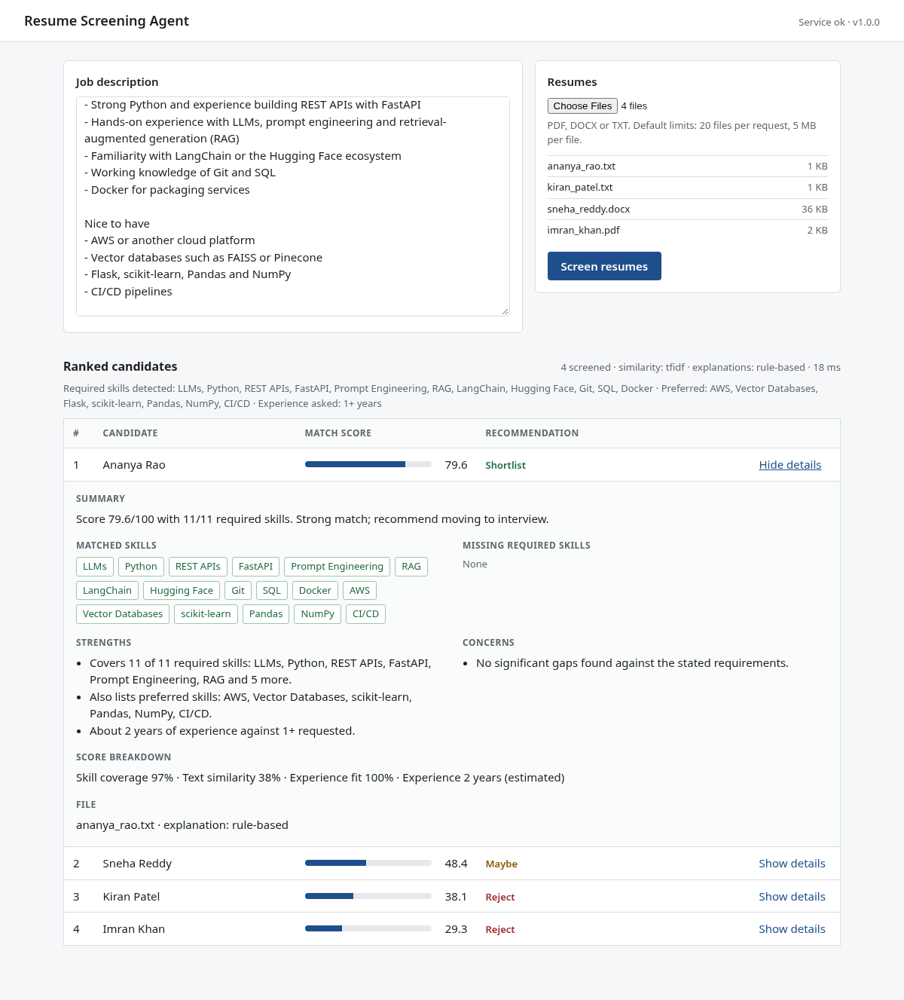
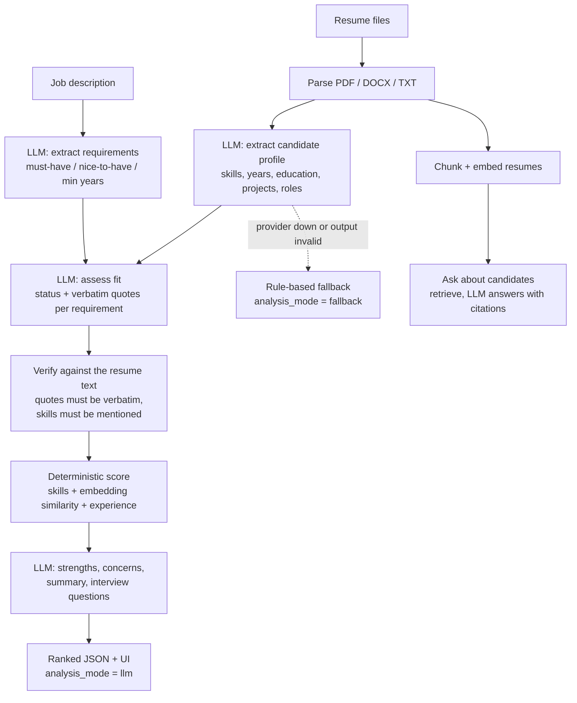

# AI Resume Screening Agent

An LLM-powered service that screens resumes against a job description. An LLM reads each resume and the job description, extracts structured data, checks every requirement against quoted evidence from the resume, and writes the strengths, concerns and tailored interview questions. A deterministic scorer then turns the verified data into a 0-100 match score and a Shortlist / Maybe / Reject recommendation. You can also ask questions about the screened candidates and get answers with citations to resume passages.

**Live demo: https://resumelens-ai-screening.vercel.app** (hosted on Vercel's free tier, FastAPI serverless function). The demo runs in **fallback mode** (rule-based analysis, no LLM) unless an LLM key is set: set `LLM_API_KEY` (and optionally `LLM_PROVIDER`) in the Vercel project's environment variables to switch it to LLM mode. Interactive API docs are at `/docs`. The first request after idle can take a few seconds (cold start).

Built as an internship project (Blackbucks Internships 2026, Generative AI Engineer) by Beernelli Vishnu Vardhan, B.Tech CSIT, MVSR Engineering College.



The screenshot above is real model output (`qwen2.5:1.5b` through Ollama on a CPU-only machine). `docs/screenshot_fallback.png` shows the same screening in the offline fallback mode.

## Problem

A recruiter's first pass over a stack of resumes checks the same things each time: required skills, roughly enough experience, relevant projects. This project automates that pass and shows its evidence, so a reviewer can check the result instead of trusting it. It is a screening aid, not a hiring decision maker.

## How it works



The principle is **the LLM proposes, deterministic code checks**. Everything a model returns is validated against a Pydantic schema, and then checked against the resume text before it can affect a score:

| What the LLM returns | What is checked before it is used |
|---|---|
| JSON of any shape | Schema validation, then one repair attempt that sends the validation error back to the model. If the second reply is also invalid the step falls back. |
| Candidate skills | A skill counts only if the resume literally mentions it (name or alias). Others are listed as `unsupported_skills` and never scored. |
| Evidence quotes | A quote counts only if it appears verbatim in the resume (whitespace-insensitive). A status of "met" needs a verified quote that names the requirement; otherwise it is downgraded to "partial" or "unverified". If the resume does name a requirement the model missed, the literal line is used instead. |
| JD requirements | Dropped, with a warning, if the job description does not mention them. |
| Years of experience | If the model's figure differs by more than a year from date arithmetic on the resume, the date-based figure is used and a warning is added. |
| Candidate name | Used only if it appears in the resume text. |

### Why the score is not produced by the LLM

```
score = 100 * (0.55 * skill_coverage + 0.30 * text_similarity + 0.15 * experience_fit)
```

A model-generated number changes between runs and models, cannot be explained, and is the obvious target for a prompt injection ("score this resume 100"). So the LLM supplies the *inputs* (structured requirements, verified skills, evidence) and the arithmetic is fixed. The same resume therefore gets the same score whatever wording the model chooses for its summary, which is tested (`test_score_is_deterministic_function_of_extracted_data`, `test_prompt_injection_in_resume_cannot_change_the_score`).

- **skill_coverage**: share of job requirements the resume demonstrably covers. Must-have counts 1, nice-to-have counts 0.5.
- **text_similarity**: cosine similarity between job description and resume (`all-MiniLM-L6-v2` embeddings if installed, otherwise TF-IDF), divided by a per-backend constant and capped at 1. The constants are hand-picked, not learned.
- **experience_fit**: candidate years divided by the years the job asks for, capped at 1.
- A component with no data (for example a job with no stated years) is dropped and the weights renormalised.
- 70 and above is Shortlist, 45 to 69.9 Maybe, below 45 Reject.

### Prompts

Prompts are versioned files in `app/prompts/v1/` (`extract_job`, `extract_resume`, `assess_fit`, `write_report`, `answer_question`, `repair`). Each has a system section and a user section. Set `PROMPT_VERSION` to use another directory. Resume and job text is always wrapped in tags and the system prompt states that it is untrusted data whose instructions must be ignored. The prompt version is part of the cache key.

### Analysis modes

Every response carries `analysis_mode`: `llm` or `fallback`, at the top level and per candidate. The UI shows a banner and a tag per candidate.

- `llm`: every step for that candidate came from the model.
- `fallback`: at least one step used the rule-based engine (keyword skill taxonomy, regex years, template text). Warnings say which step and why.
- If the very first call (job requirement extraction) fails, the provider is assumed to be down. The whole run uses the rule-based engine instead of timing out once per resume, and `llm_model` is `null`.

The rule-based path is an explicit offline fallback, not a second product. Its explanations are template text, and its skill matching is limited to a 77-skill taxonomy in `app/data/skills.json`.

### Ask about candidates (RAG)

After a screening, `POST /ask` answers a question about those candidates. Resumes were split into overlapping line-based chunks of at most 600 characters at screening time. A question is embedded with the same backend as the similarity score, the top `ASK_TOP_K` chunks are retrieved (a question that names a candidate searches only that candidate's chunks), and the LLM answers from the numbered excerpts with citation numbers. Citations that do not match a retrieved excerpt are dropped, and `grounded` is `false` when an answer has none. Without an LLM the endpoint returns the most relevant excerpts and says so.

## LLM providers

All providers go through one OpenAI-compatible client (`app/llm/client.py`, `httpx`). Choose with `LLM_PROVIDER`:

| Provider | `LLM_PROVIDER` | Default model | Needs |
|---|---|---|---|
| Groq (default, free tier) | `groq` | `llama-3.1-8b-instant` | `LLM_API_KEY` from console.groq.com |
| OpenAI | `openai` | `gpt-4o-mini` | `LLM_API_KEY` |
| OpenRouter | `openrouter` | `meta-llama/llama-3.1-8b-instruct` | `LLM_API_KEY` |
| Ollama (local) | `ollama` | `qwen2.5:1.5b` | A running Ollama with the model pulled |
| Any OpenAI-compatible server | `custom` | none | `LLM_BASE_URL`, `LLM_MODEL` |
| No LLM | `none` | none | Fallback mode only |

If the provider is `groq` (the default) but no key is set, the app starts in fallback mode and says so on `/health`.

Quick start with Groq: create a free key at https://console.groq.com/keys, then

```bash
cp .env.example .env        # set LLM_API_KEY=gsk_...
uvicorn app.main:app
```

Quick start with Ollama:

```bash
ollama pull qwen2.5:1.5b
LLM_PROVIDER=ollama LLM_MODEL=qwen2.5:1.5b LLM_TIMEOUT_SECONDS=120 LLM_MAX_CONCURRENCY=1 uvicorn app.main:app
```

Reliability: per-request timeout (`LLM_TIMEOUT_SECONDS`), retries with exponential backoff on connection errors, 429 and 5xx (honouring `Retry-After`), a semaphore capping simultaneous calls (`LLM_MAX_CONCURRENCY`), and no API key in logs or error messages. Responses that pass validation are cached on disk under `LLM_CACHE_DIR`, keyed by a SHA-256 of the model name, prompt version, prompt name and full rendered prompt; invalid output is never cached.

**Privacy.** Resume text is sent to the configured provider. The disk cache also stores resume-derived output. Do not use a hosted provider or the cache for data you may not share: use Ollama and set `LLM_CACHE_ENABLED=false`, or clear `LLM_CACHE_DIR`.

## Tech stack

- Python 3.11+, FastAPI, Pydantic v2, pydantic-settings, httpx
- pypdf, python-docx
- scikit-learn (TF-IDF), sentence-transformers (optional)
- Plain HTML, CSS and JavaScript front end (no build step)
- pytest, ruff, GitHub Actions, Docker

## Project layout

```
app/
  main.py              application factory, static file mount
  api/                 routes (/screen, /ask, /health) and dependency wiring
  core/                settings and provider presets, logging, error types
  llm/                 OpenAI-compatible client, structured output + repair, disk cache, prompt loader
  prompts/v1/          versioned prompt files
  models/              schemas.py (API) and genai.py (LLM output schemas)
  services/            parser, skills, experience, similarity, scoring,
                       engine / llm_engine (LLM and rule-based analysis), evidence checks,
                       reasoning (fallback text), rag, pipeline
  data/skills.json     skill taxonomy (used by the fallback and for name normalisation)
static/                web UI
samples/               sample job description and four fictional resumes
tests/                 pytest suite (LLM is always mocked, no network)
scripts/               sample file generator, screenshot capture
```

## Setup

```bash
python3 -m venv .venv
source .venv/bin/activate            # Windows: .venv\Scripts\activate
pip install -r requirements.txt
cp .env.example .env                 # then set LLM_API_KEY, or LLM_PROVIDER=ollama
uvicorn app.main:app --reload
```

Open http://127.0.0.1:8000. API docs are at http://127.0.0.1:8000/docs.

Optional sentence embeddings (downloads PyTorch and the model): `pip install -r requirements-embeddings.txt`. With `EMBEDDING_BACKEND=auto` the app uses them if available and otherwise uses TF-IDF.

### Docker

```bash
docker build -t resume-screening-agent .
docker run --rm -p 8000:8000 --env-file .env resume-screening-agent
```

To reach Ollama on the host from a container use `LLM_BASE_URL=http://host.docker.internal:11434/v1` with `LLM_PROVIDER=custom`. The Dockerfile has not been built or tested, and CI does not build the image.

### Tests and lint

```bash
pip install -r requirements-dev.txt
pytest
ruff check . && ruff format --check .
```

The tests never touch the network. The LLM is replaced by a scripted fake (`tests/fakes.py`) or by `httpx.MockTransport`. They cover JSON extraction and validation, the repair retry, retries and timeouts, caching, evidence verification, fallback switching (per step and whole run), the injection and determinism properties above, RAG retrieval and citation filtering, and the API.

## Configuration

Environment variables or `.env`; see `.env.example` for all of them with comments.

| Variable | Default | Purpose |
|----------|---------|---------|
| `LLM_PROVIDER` | `groq` | `groq`, `openai`, `openrouter`, `ollama`, `custom` or `none` |
| `LLM_API_KEY` | unset | Key for hosted providers |
| `LLM_BASE_URL`, `LLM_MODEL` | provider preset | Override the preset |
| `LLM_TIMEOUT_SECONDS` | `60` | Per-request timeout |
| `LLM_MAX_RETRIES` | `2` | Retries on transient errors |
| `LLM_MAX_CONCURRENCY` | `2` | Simultaneous LLM calls |
| `LLM_JSON_MODE` | `true` | Request `response_format=json_object` |
| `LLM_CACHE_ENABLED`, `LLM_CACHE_DIR` | `true`, `.cache/llm` | Disk cache |
| `PROMPT_VERSION` | `v1` | Directory under `app/prompts/` |
| `ASK_TOP_K`, `MAX_QUESTION_CHARS` | `5`, `500` | Ask endpoint |
| `MAX_SCREENINGS_KEPT` | `20` | Screenings kept in memory for questions |
| `EMBEDDING_BACKEND` | `auto` | `auto`, `tfidf` or `sbert` |
| `MAX_FILE_SIZE_MB`, `MAX_FILES` | `5`, `20` | Upload limits |
| `WEIGHT_SKILLS`, `WEIGHT_SEMANTIC`, `WEIGHT_EXPERIENCE` | `0.55`, `0.30`, `0.15` | Score weights |
| `SHORTLIST_THRESHOLD`, `MAYBE_THRESHOLD` | `70`, `45` | Recommendation cut-offs |

## API

### `GET /health`

```json
{"status": "ok", "version": "1.0.0", "llm_enabled": true, "llm_model": "qwen2.5:1.5b"}
```

### `POST /screen`

`multipart/form-data` with `job_description` (text, 40 to 20,000 characters) and `resumes` (one or more `.pdf`, `.docx` or `.txt` files).

```bash
curl -X POST http://127.0.0.1:8000/screen \
  -F "job_description=<samples/job_description.txt" \
  -F "resumes=@samples/ananya_rao.txt" \
  -F "resumes=@samples/kiran_patel.txt" \
  -F "resumes=@samples/sneha_reddy.docx" \
  -F "resumes=@samples/imran_khan.pdf"
```

Response (trimmed; real output of `qwen2.5:1.5b`):

```json
{
  "screening_id": "3f9c...",
  "analysis_mode": "llm",
  "llm_model": "qwen2.5:1.5b",
  "job": {
    "must_have": ["Python", "FastAPI", "LLMs", "Prompt Engineering", "RAG", "Git", "SQL", "Docker"],
    "nice_to_have": ["AWS", "Vector Databases", "Flask", "scikit-learn", "Pandas", "NumPy", "CI/CD"],
    "min_years": 1.0
  },
  "candidates": [
    {
      "rank": 1,
      "name": "Ananya Rao",
      "score": 92.2,
      "recommendation": "Shortlist",
      "analysis_mode": "llm",
      "matched_skills": ["Python", "FastAPI", "LLMs", "..."],
      "missing_skills": [],
      "unsupported_skills": [],
      "unsupported_claims": [],
      "evidence": [
        {"requirement": "Python", "status": "met",
         "quotes": ["Software engineer focused on LLM-backed backend services. Roughly 2 years of experience in Python development."]}
      ],
      "years_experience": 2.5,
      "breakdown": {"skill_coverage": 95.7, "semantic_similarity": 38.4, "experience_fit": 100.0},
      "strengths": ["..."],
      "concerns": ["..."],
      "summary": "...",
      "interview_questions": ["...", "...", "..."]
    }
  ],
  "rejected_files": [],
  "warnings": [],
  "similarity_backend": "sbert",
  "llm_enabled": true,
  "processing_ms": 61
}
```

Candidates are sorted by score, highest first. A file that cannot be read (wrong type, empty, corrupt, password protected, scanned image, too large) does not fail the request; it is listed in `rejected_files`.

### `POST /ask`

```bash
curl -X POST http://127.0.0.1:8000/ask -H "Content-Type: application/json" \
  -d '{"screening_id": "3f9c...", "question": "Which candidate has built a RAG system with LangChain?"}'
```

```json
{
  "answer": "Ananya Rao",
  "citations": [{"ref": 3, "candidate": "Ananya Rao", "filename": "ananya_rao.txt", "excerpt": "..."}],
  "analysis_mode": "llm",
  "grounded": true
}
```

**Errors** return `{"detail": "...", "code": "..."}`:

| Status | Code | When |
|--------|------|------|
| 422 | `invalid_request` | Bad job description length, too many files, empty or over-long question, missing field |
| 422 | `no_valid_resumes` | Every file was rejected; `rejected_files` explains each |
| 404 | `screening_not_found` | Unknown or expired `screening_id` (screenings are kept in memory and lost on restart) |

## Sample results

The four fictional resumes against `samples/job_description.txt`, with the sentence-embedding backend:

| Candidate | `llm` mode (qwen2.5:1.5b) | `fallback` mode |
|-----------|---------------------------|-----------------|
| Ananya Rao | 92.2 Shortlist | 95.1 Shortlist |
| Sneha Reddy | 69.0 Maybe | 59.8 Maybe |
| Kiran Patel | 55.2 Maybe | 50.3 Maybe |
| Imran Khan | 38.5 Reject | 40.8 Reject |

Both modes give the same order. The real run took about 2 minutes the first time (four resumes, one call at a time on CPU, 13 model calls) and under a second with a warm cache. This is a four-resume demonstration, not an evaluation: no accuracy figure was measured.

## Known limitations

- **Small-model quality.** The demo used a 1.5B parameter model. Its structured extraction and evidence quoting are usable because they are verified, but its free-text output is weaker. For example, it wrote "Missing experience in AWS and Vector Databases" for a candidate whose evidence table shows both as met, and its interview questions are sometimes clumsy. The score does not depend on that text, but the text can contradict the evidence table. A larger model (Groq's llama-3.1-8b-instant or better) is expected to do better; that has not been measured here.
- **`/ask` can be wrong.** With the same 1.5B model, "Does Imran Khan have any Python experience?" was answered "Yes" with citations to excerpts that do not mention Python. Citations let a reader check, but the check is manual: the app verifies that a citation points at a retrieved excerpt, not that the excerpt supports the answer.
- **Verification is lexical.** A quote must be verbatim and a skill must be named. A candidate who describes containerisation without writing "Docker" is marked as not found by the checks (the LLM's "met" is downgraded).
- Years of experience are overruled by date arithmetic, which can itself be wrong for unusual date formats. The minimum years the model extracts from the job description is not cross-checked.
- Prompts cap each document at 6000 characters (Ollama's default context is small), so very long resumes are truncated.
- RAG re-embeds chunks for every question and keeps screenings in memory only. There is no vector database.
- The disk cache stores resume-derived text (see the privacy note).
- Scanned PDFs are rejected; there is no OCR.
- Score weights and similarity constants are defaults, not tuned on labelled data.
- No authentication, rate limiting or persistent storage. Add them before exposing the service.
- Docker image and GitHub Actions workflow have not been run.
- A scoring system on resume text can reproduce bias present in the data. It should assist, not replace, human review.

## Future scope

- Evaluate on labelled resume and job pairs; compare models and prompt versions with that set
- Check that cited excerpts actually support an answer (entailment check)
- Persist screenings and embeddings, export results as CSV
- OCR for scanned resumes
- Authentication and per-user history
- Bias and fairness review of the scoring features before any real use

## License

MIT. See [LICENSE](LICENSE).
