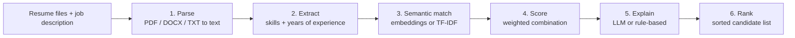

# AI Resume Screening Agent

A small web service that ranks resumes against a job description. Upload one or more resumes (PDF, DOCX or TXT), paste the job description, and get a ranked list with a 0-100 match score, matched and missing skills, strengths, concerns and a Shortlist / Maybe / Reject recommendation.

Built as an internship project (Blackbucks Internships 2026, Generative AI Engineer track) by Beernelli Vishnu Vardhan, B.Tech CSIT, MVSR Engineering College.


## Problem

Recruiters spend most of their first pass on a stack of resumes checking the same things: does the candidate have the required skills, roughly enough experience, and relevant background. This project automates that first pass and explains each result so the ranking can be checked rather than trusted blindly. It is a screening aid, not a hiring decision maker.

## How it works



| Step | Module | What it does |
|------|--------|--------------|
| Parse | `app/services/parser.py` | Reads PDF (pypdf), DOCX (python-docx) and TXT. Validates content, not just the extension, and guesses the candidate name. |
| Extract | `app/services/skills.py`, `experience.py` | Matches skills against a taxonomy in `app/data/skills.json`. Separates required from optional skills in the job description using section headings. Estimates years of experience from explicit statements or date ranges. |
| Semantic match | `app/services/similarity.py` | Cosine similarity between the job description and each resume. Uses `all-MiniLM-L6-v2` sentence embeddings when available, otherwise TF-IDF. |
| Score | `app/services/scoring.py` | Combines the three signals into one score and maps it to a recommendation. |
| Explain | `app/services/reasoning.py` | Writes strengths, concerns and a summary. Uses an LLM if configured, otherwise a deterministic rule-based writer. |
| Rank | `app/services/pipeline.py` | Orchestrates the steps and sorts candidates by score. |

### Scoring

```
score = 100 * (0.55 * skill_coverage + 0.30 * text_similarity + 0.15 * experience_fit)
```

- **skill_coverage**: share of job skills found in the resume. Required skills count 1, preferred skills count 0.5.
- **text_similarity**: cosine similarity divided by a per-backend constant (0.45 for TF-IDF, 0.8 for embeddings) and capped at 1. The constants are hand-picked so typical good matches land near the top of the range; they are not learned from data.
- **experience_fit**: candidate years divided by the years the job asks for, capped at 1. Unknown experience scores 0.
- If the job description has no recognised skills or no stated years, that component is dropped and the other weights are renormalised.
- Recommendation: 70 and above is Shortlist, 45 to 69.9 is Maybe, below 45 is Reject.

Weights and thresholds are configurable (see [Configuration](#configuration)).

The recommendation always comes from the score, never from the LLM. The LLM only writes the explanation text.

### LLM step and offline behaviour

The explanation step is pluggable. Set `LLM_API_KEY` to use any OpenAI-compatible chat completions endpoint (Groq by default; OpenAI, Hugging Face Inference endpoints that expose the same API, or a local server work by changing `LLM_BASE_URL` and `LLM_MODEL`).

If no key is set, or a call fails (timeout, HTTP error, malformed output), the rule-based writer produces the explanation instead. The application works fully offline; each result reports which writer produced its text in the `reasoner` field.

When an LLM is configured, an excerpt of each resume (first 3000 characters) is sent to that provider. Do not enable it for data you are not allowed to share. Resume text is treated as untrusted in the prompt, and since the LLM cannot change the score or recommendation, an injected instruction in a resume can at most affect the wording of its own explanation.

## Tech stack

- Python 3.11+, FastAPI, Pydantic v2, pydantic-settings
- pypdf, python-docx
- scikit-learn (TF-IDF), sentence-transformers (optional)
- httpx for the LLM call
- Plain HTML, CSS and JavaScript front end served by FastAPI (no build step)
- pytest, ruff, GitHub Actions, Docker

## Project layout

```
app/
  main.py            application factory, static file mount
  api/               routes and dependencies
  core/              settings, logging, error types
  models/schemas.py  request/response models
  services/          parser, skills, experience, similarity, scoring, reasoning, pipeline
  data/skills.json   skill taxonomy
static/              web UI
samples/             sample job description and four fictional resumes
tests/               pytest suite
scripts/             sample file generator, screenshot capture
```

## Setup

```bash
python3 -m venv .venv
source .venv/bin/activate            # Windows: .venv\Scripts\activate
pip install -r requirements.txt
uvicorn app.main:app --reload
```

Open http://127.0.0.1:8000. The interactive API docs are at http://127.0.0.1:8000/docs.

Optional extras:

```bash
pip install -r requirements-embeddings.txt   # sentence embeddings (downloads PyTorch and the model)
cp .env.example .env                          # then edit, for example to set LLM_API_KEY
```

With `EMBEDDING_BACKEND=auto` (the default) the app uses embeddings when `sentence-transformers` is installed and the model loads, and otherwise logs a warning and uses TF-IDF.

### Docker

```bash
docker build -t resume-screening-agent .
docker run --rm -p 8000:8000 --env-file .env resume-screening-agent
# include embeddings: docker build --build-arg INSTALL_EMBEDDINGS=true -t resume-screening-agent .
```

The Dockerfile has not been built or tested yet, and CI does not build the image.

### Tests and lint

```bash
pip install -r requirements-dev.txt
pytest
ruff check . && ruff format --check .
```

## Configuration

All settings are environment variables (or entries in `.env`). See `.env.example` for the full list.

| Variable | Default | Purpose |
|----------|---------|---------|
| `EMBEDDING_BACKEND` | `auto` | `auto`, `tfidf` or `sbert` |
| `LLM_API_KEY` | unset | Enables the LLM explanation step |
| `LLM_BASE_URL` | `https://api.groq.com/openai/v1` | OpenAI-compatible base URL |
| `LLM_MODEL` | `llama-3.1-8b-instant` | Model name sent to the provider |
| `MAX_FILE_SIZE_MB` | `5` | Per-file upload limit |
| `MAX_FILES` | `20` | Files per request |
| `WEIGHT_SKILLS`, `WEIGHT_SEMANTIC`, `WEIGHT_EXPERIENCE` | `0.55`, `0.30`, `0.15` | Score weights |
| `SHORTLIST_THRESHOLD`, `MAYBE_THRESHOLD` | `70`, `45` | Recommendation cut-offs |

## API

### `GET /health`

```json
{"status": "ok", "version": "1.0.0", "llm_enabled": false}
```

### `POST /screen`

`multipart/form-data` with:

- `job_description` (text, 40 to 20,000 characters)
- `resumes` (one or more files: `.pdf`, `.docx`, `.txt`)

```bash
curl -X POST http://127.0.0.1:8000/screen \
  -F "job_description=<samples/job_description.txt" \
  -F "resumes=@samples/ananya_rao.txt" \
  -F "resumes=@samples/kiran_patel.txt" \
  -F "resumes=@samples/sneha_reddy.docx" \
  -F "resumes=@samples/imran_khan.pdf"
```

Response (trimmed to the first candidate):

```json
{
  "job": {
    "required_skills": ["LLMs", "Python", "REST APIs", "FastAPI", "Prompt Engineering", "RAG",
                        "LangChain", "Hugging Face", "Git", "SQL", "Docker"],
    "preferred_skills": ["AWS", "Vector Databases", "Flask", "scikit-learn", "Pandas", "NumPy", "CI/CD"],
    "required_years": 1.0
  },
  "candidates": [
    {
      "rank": 1,
      "name": "Ananya Rao",
      "filename": "ananya_rao.txt",
      "score": 79.6,
      "recommendation": "Shortlist",
      "matched_skills": ["LLMs", "Python", "REST APIs", "FastAPI", "..."],
      "missing_skills": [],
      "missing_preferred_skills": ["Flask"],
      "years_experience": 2.0,
      "breakdown": {"skill_coverage": 96.6, "semantic_similarity": 38.4, "experience_fit": 100.0},
      "strengths": ["Covers 11 of 11 required skills: ..."],
      "concerns": ["No significant gaps found against the stated requirements."],
      "summary": "Score 79.6/100 with 11/11 required skills. Strong match; recommend moving to interview.",
      "reasoner": "rule_based"
    }
  ],
  "rejected_files": [],
  "warnings": [],
  "similarity_backend": "tfidf",
  "llm_enabled": false,
  "processing_ms": 41
}
```

Candidates are sorted by score, highest first.

**Errors** return `{"detail": "...", "code": "..."}`:

| Status | Code | When |
|--------|------|------|
| 422 | `invalid_request` | Job description too short or too long, too many files, or a missing field |
| 422 | `no_valid_resumes` | Every file was rejected; the body includes `rejected_files` with a reason for each |

A file that cannot be read (wrong type, empty, corrupt, password protected, scanned image, over the size limit) does not fail the request. It is listed in `rejected_files` and the remaining resumes are still screened.

## Sample results

Running the four sample resumes against `samples/job_description.txt` (all four resumes are fictional):

| Rank | Candidate | Score (TF-IDF) | Recommendation | Score (embeddings) |
|------|-----------|----------------|----------------|--------------------|
| 1 | Ananya Rao | 79.6 | Shortlist | 95.1 |
| 2 | Sneha Reddy | 48.4 | Maybe | 59.8 |
| 3 | Kiran Patel | 38.1 | Reject | 50.3 (Maybe) |
| 4 | Imran Khan | 29.3 | Reject | 40.8 |

The ordering is the same with both backends, but absolute scores differ, and the embedding backend scores unrelated text higher. This is a four-resume demonstration, not an evaluation: no accuracy figure has been measured.

## Screenshots

The screenshot at the top (`docs/screenshot.png`) shows the UI after screening the sample files with the TF-IDF backend, with the first candidate's details expanded. It can be regenerated with `python scripts/capture_screenshot.py` while the server is running (needs Playwright and Chrome).

## Known limitations

- Skill matching is keyword based. "Docker" is matched, "containerisation" is not, and the taxonomy covers 77 common technical skills. Extend `app/data/skills.json` for other domains.
- A job description line such as "Flask or FastAPI" counts both skills as required. Write alternatives as separate sections or mark one as preferred.
- Years of experience are estimated from "N years of experience" statements or date ranges and can be wrong for unusual formats. Lines mentioning degrees or schools are ignored.
- Scanned (image-only) PDFs are rejected; there is no OCR.
- `all-MiniLM-L6-v2` reads about the first 256 word pieces of each text, so long resumes are only partly represented in the embedding score.
- Score weights and normalisation constants are reasonable defaults, not tuned on labelled data. Treat scores as a ranking aid.
- There is no authentication, rate limiting or storage. Uploaded files are processed in memory and discarded. Add these before exposing the service publicly.

## Future scope

- Evaluate against labelled resume and job pairs and tune weights from that data
- OCR for scanned resumes
- Skill extraction beyond a fixed taxonomy (for example embedding-based skill matching)
- Persisting screening sessions and exporting results as CSV
- Authentication and per-user history
- Bias and fairness review of the scoring features before any real-world use

## License

MIT. See [LICENSE](LICENSE).
